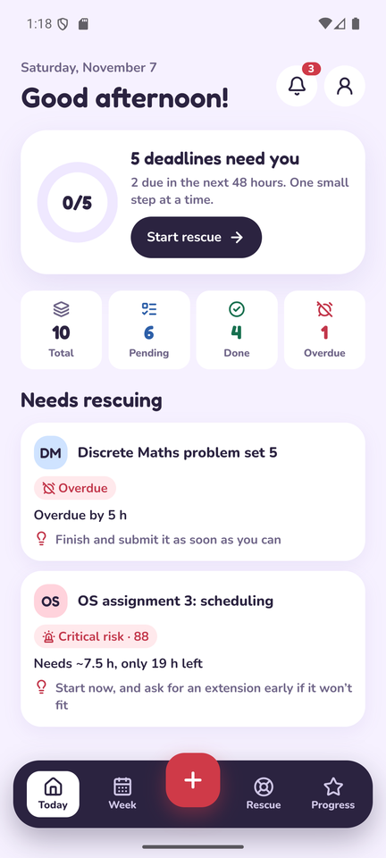
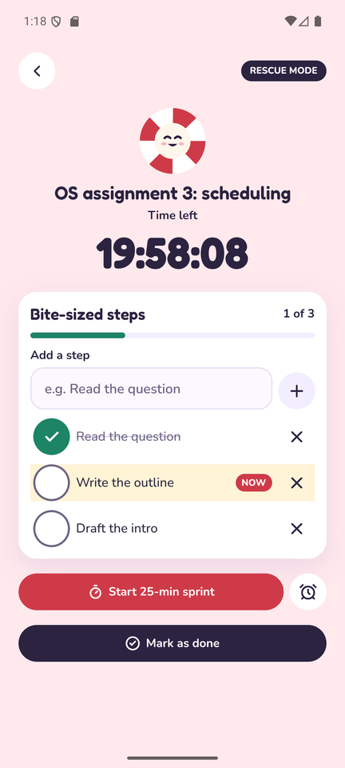
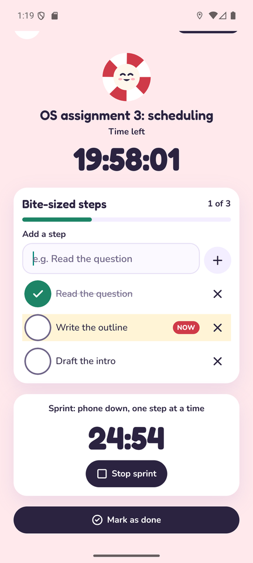
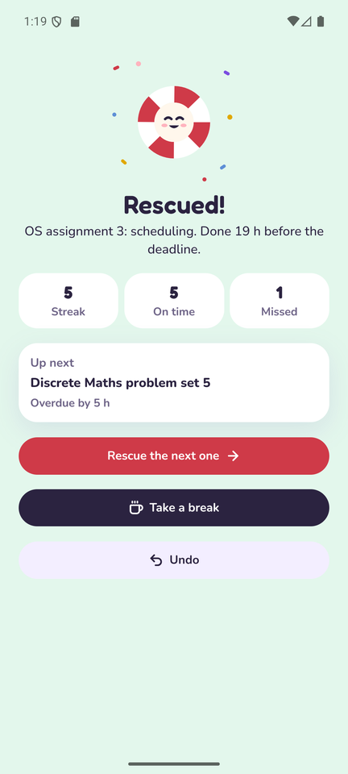
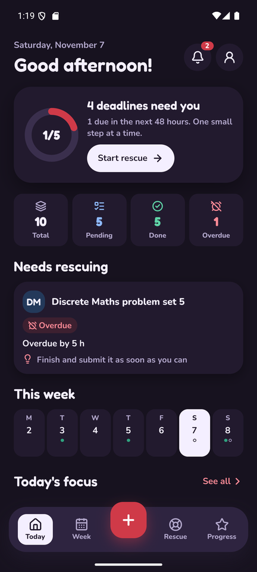

# Deadline Rescue

An offline Android app that shows students which deadlines are really at risk, and helps them get the work done. No account and no internet needed.

**[Download the APK](https://github.com/AshikaM07/deadline-rescue-app/releases/latest)** · [Watch the demo](demo.mp4) · Built with React Native and Expo

| Today | Rescue mode | Sprint | Rescued! | Dark theme |
|---|---|---|---|---|
|  |  |  |  |  |

Screenshots use sample data.

## The problem

Calendar apps show when work is due, not whether you still have time to do it. A 10-hour assignment due in two days is in more trouble than a 30-minute quiz due tomorrow, but a calendar treats them the same.

## What it does

- **Risk scoring:** ranks every deadline by the work left and the time left, and explains the reason and the next step.
- **Rescue mode:** a live countdown, bite-sized steps and a 25-minute sprint timer.
- **Exam mode and repeating deadlines:** plans revision across the days left, and adds next week's lab record when you finish this one.
- **Home-screen widget:** shows the most at-risk deadlines without opening the app.
- **Estimate learning:** learns how long your work really takes, and adjusts your estimates on the phone.
- **Reminders:** arrive on time with the app closed and no internet, and survive a phone restart.
- **Calendar and progress charts:** show how busy your week is and how accurate your estimates are.
- **Backup:** a daily automatic backup on the phone, plus export and import of backup files.

## How it's built

| Layer | Technology |
|---|---|
| App | React Native, Expo SDK 58, JavaScript, Expo Router, NativeWind |
| Local data | SQLite with hand-written SQL and versioned migrations |
| Device features | Local notifications, haptics, file sharing |
| Testing | Jest, React Native Testing Library, real SQL tests |
| Delivery | GitHub Actions, EAS Build |

## Engineering highlights

- **Local-first.** The phone's SQLite database is the source of truth, so every feature works offline. Records are designed so optional cloud sync can be added later without a rewrite.
- **Safe data changes.** Migrations run in transactions, so a failed upgrade leaves the user's data untouched.
- **Explainable risk score.** A pure function combines workload (55 points), time left (25), priority (15) and whether work has started (5), and reports why a deadline is risky.
- **On-device learning with no ML library.** Uses the median of log ratios between estimated and actual hours, with shrinkage so a few samples can't swing it. Accuracy is measured with leave-one-out error.
- **Reliable reminders.** Each sync compares the planned reminders with the database and the phone's own list. Edits move reminders, finishing cancels them, and a crash can't create duplicates.
- **Accessibility.** Tests check WCAG AA contrast in both themes. Touch targets are 44 px, and text scales with the phone's font size.

## Quality

- 460 automated tests, 86% line coverage, run by CI on every push
- Manual device checklist run on an Android 16 emulator
- Runs on a real Android phone

## Install

1. Open the [latest release](https://github.com/AshikaM07/deadline-rescue-app/releases/latest) on an Android phone.
2. Download `deadline-rescue-1.1.0.apk` and open it.
3. Allow your browser to install apps if asked.
4. If Play Protect warns you, tap **More details > Install anyway**. It appears because the app isn't on the Play Store.

Needs Android 7 or newer on a 64-bit phone. See the [release notes](release-notes-v1.1.0.md) for known limitations, and [privacy](privacy.md) for how data is handled: it stays on your phone.

## Status

v1.1.0 is released and still being improved. The source code is in a private repository and is available on request.

## Author

**Ashika Maji**, Computer Science and Engineering student · [GitHub](https://github.com/AshikaM07)
